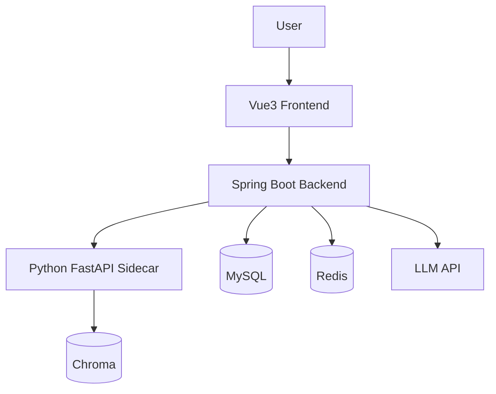

# HuiYi AI Data Assistant

> 会意 · 企业经营数据智能分析助手

基于 **Java + Python 协同架构** 的企业经营数据智能分析助手，支持 **RAG 知识库问答** 与 **Text-to-SQL 数据分析** 两类核心能力。

## 项目亮点

- **Java 主服务 + Python Sidecar 分层协同**：Java 承载业务接口、Prompt 编排、LLM 调用、SQL 执行与结果组装；Python 承载文档解析、分块、向量检索、SQL 安全校验与数据画像
- **RAG 知识库问答**：Markdown / PDF / Word 解析 → 分块 → Chroma 向量化 → Top-K 检索 → 带引用来源的回答，无命中时明确兜底
- **Text-to-SQL**：LLM 生成 SQL → sqlglot 静态安全校验（SELECT-only + 表白名单）→ 只读执行 → pandas 数据画像与图表推荐
- **工程化**：Docker Compose 一键启动、环境变量化管理敏感配置、前后端分离

## Architecture



> 详细架构说明见 [docs/architecture.md](docs/architecture.md)（P7 补齐）。

## Quick Start

### 前置要求

| 工具 | 版本 |
|---|---|
| JDK | 17 |
| Maven | 3.8+ |
| Python | 3.11+ |
| Node | 18+（P6 前端阶段使用） |
| Docker Desktop | 最新稳定版 |

### 方式一：Docker Compose 一键启动

```bash
cp .env.example .env   # 填入 LLM_BASE_URL / LLM_API_KEY / LLM_MODEL / LLM_EMBEDDING_MODEL
docker compose up -d
```

> 说明：容器 MySQL 默认映射到宿主机 **3307** 端口（规避本机 MySQL 占用的 3306），
> 可通过 `.env` 中 `MYSQL_HOST_PORT` 修改。

### 方式二：本地开发模式

```bash
# 1. 启动基础设施（MySQL + Redis）
docker compose up -d mysql redis

# 2. 启动 Python Sidecar（端口 8001）
cd python-service
python -m venv .venv && .venv\Scripts\activate   # Windows
pip install -r requirements.txt
uvicorn app.main:app --port 8001

# 3. 启动 Java 主服务（端口 8080；若与容器后端冲突可指定 SERVER_PORT=8081）
cd backend
mvn spring-boot:run
```

### 健康检查

```bash
curl http://localhost:8080/api/health   # Java 主服务 → {"code":0,"message":"ok"}
curl http://localhost:8001/health       # Python Sidecar → {"status":"ok"}
```

## Tech Stack

| 层 | 技术 |
|---|---|
| 后端主服务 | Java 17 / Spring Boot 3 / SpringAI / MyBatis-Plus / MySQL / Redis |
| Python Sidecar | Python 3.11 / FastAPI / Chroma / pandas / sqlglot / PyMuPDF |
| 前端 | Vue3 / TypeScript / Vite / Element Plus / ECharts（P6 交付） |
| LLM | OpenAI 兼容 API（chat + embedding） |
| 部署 | Docker / Docker Compose / GitHub Actions |

## 目录结构

```text
huiyi-ai-data-assistant/
├── backend/            # Java 主服务（Spring Boot 3）
├── python-service/     # Python Sidecar（FastAPI）
├── frontend/           # Vue3 前端（P6 阶段交付）
├── docs/               # 架构 / API / 演示文档
├── sample-data/        # 示例知识库与业务数据
├── scripts/            # 数据库初始化与本地启动脚本
├── docker-compose.yml  # 一键编排
└── .env.example        # 环境变量模板
```

## Roadmap

- [x] **M1 骨架可运行**：双端健康检查 + Compose 一键启动
- [x] **M2 知识库链路贯通**：上传 → 解析 → 分块 → 向量检索
- [ ] **M3 RAG 问答可用**：引用来源 / SSE 流式 / 会话落库
- [ ] **M4 数据查询可用**：Text-to-SQL + 四道安全防线
- [ ] **M5 端到端可演示**：五场景前端演示
- [ ] **M6 开源就绪**：测试 / 文档 / Demo GIF / CI 齐备

## License

[MIT](LICENSE)
