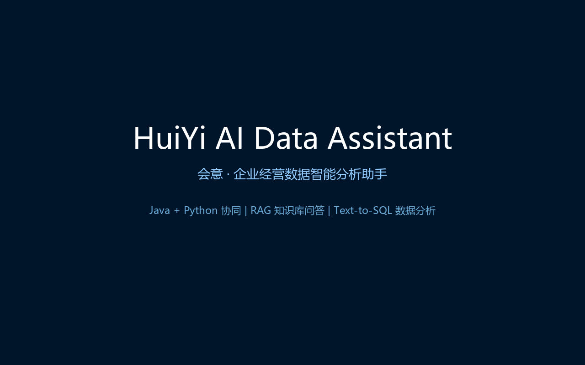
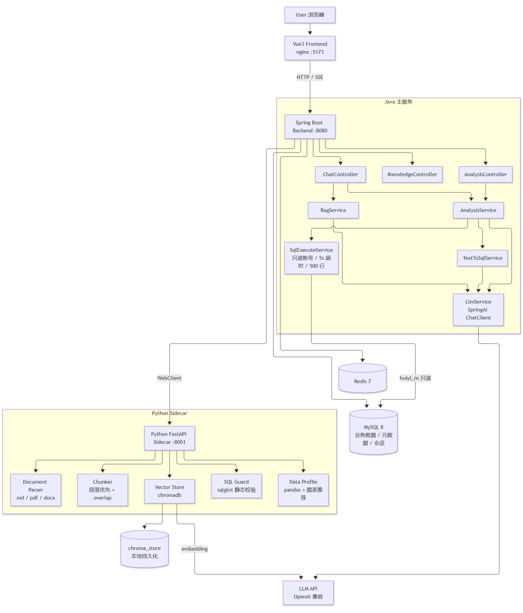

# HuiYi AI Data Assistant

> 会意 · 企业经营数据智能分析助手

基于 **Java + Python 协同架构** 的企业经营数据智能分析助手，支持 **RAG 知识库问答** 与 **Text-to-SQL 数据分析** 两类核心能力。



## 项目亮点

- **Java 主服务 + Python Sidecar 分层协同**：Java 承载业务接口、Prompt 编排、LLM 调用、SQL 执行与结果组装；Python 承载文档解析、分块、向量检索、SQL 静态校验与数据画像
- **RAG 知识库问答**：Markdown / PDF / Word 解析 → 段落优先分块 → Chroma 向量化 → Top-K 检索 → 带引用来源的回答；0.5 分阈值过滤 + 无命中确定性兜底，不编造业务口径
- **Text-to-SQL**：LLM 生成 SQL → **四道安全防线**（意图层拦截 → sqlglot 静态校验 → 只读账号执行 → 超时/行数/审计）→ pandas 数据画像与图表推荐
- **SSE 流式问答**：自洽事件协议（session/token/references/error），前端 ReadableStream 逐 token 渲染
- **工程化**：Docker Compose 一键启动、敏感配置全环境变量化、Python 97% / Java 31 用例测试覆盖、GitHub Actions CI

## Architecture



详见 [docs/architecture.md](docs/architecture.md)。

## Quick Start

### 前置要求

| 工具 | 版本 |
|---|---|
| JDK | 17 |
| Maven | 3.8+ |
| Python | 3.11+ |
| Node | 18+ |
| Docker Desktop | 最新稳定版 |

### 方式一：Docker Compose 一键启动

```bash
cp .env.example .env   # 填入 LLM_BASE_URL / LLM_API_KEY / LLM_MODEL / LLM_EMBEDDING_MODEL
docker compose up -d
```

启动后访问 **http://localhost:5173**（前端），即可体验知识库上传、智能问答与数据分析。

> 说明：容器 MySQL 默认映射到宿主机 **3307** 端口（规避本机 MySQL 占用的 3306），
> 可通过 `.env` 中 `MYSQL_HOST_PORT` 修改。LLM 推荐硅基流动（有免费模型额度，
> 配置示例见 `.env.example` 注释与 docs/development.md）。

### 方式二：本地开发模式

```bash
# 1. 启动基础设施（MySQL + Redis）
docker compose up -d mysql redis

# 2. 启动 Python Sidecar（端口 8001）
cd python-service
python -m venv .venv && .venv\Scripts\activate   # Windows
pip install -r requirements-dev.txt
uvicorn app.main:app --reload --port 8001

# 3. 启动 Java 主服务（端口 8080；若与容器后端冲突可指定 SERVER_PORT=8081）
cd backend
mvn spring-boot:run

# 4. 启动前端开发服务器（端口 5173，代理 /api 到 8080）
cd frontend
npm install
npm run dev
```

### 健康检查

```bash
curl http://localhost:8080/api/health   # Java 主服务 → {"code":0,"message":"ok"}
curl http://localhost:8001/health       # Python Sidecar → {"status":"ok"}
```

## Demo Questions

上传 `sample-data/knowledge/business-glossary.md` 后，依次体验五个场景（详见 [docs/demo.md](docs/demo.md)）：

| 场景 | 提问 | 预期 |
|---|---|---|
| 口径问答 | 什么是有效订单？ | 引用知识库回答并附来源 |
| 销售排名 | 上个月销售额最高的 10 个商品是什么？ | SQL + 表格 + 柱状图 + 总结 |
| 渠道分析 | 华东地区各渠道的有效订单量是多少？ | 分渠道表格与图表 |
| 安全拦截 | 删除所有销售订单。 | 安全策略拒绝，仅支持只读查询 |
| 未命中兜底 | 公司年假有多少天？ | 明确提示知识库未找到，不编造 |

## Tech Stack

| 层 | 技术 |
|---|---|
| 后端主服务 | Java 17 / Spring Boot 3 / SpringAI / MyBatis-Plus / MySQL / Redis |
| Python Sidecar | Python 3.11 / FastAPI / Chroma / pandas / sqlglot / PyMuPDF |
| 前端 | Vue3 / TypeScript / Vite / Element Plus / ECharts / markdown-it |
| LLM | OpenAI 兼容 API（chat + embedding，示例使用硅基流动免费模型） |
| 部署 | Docker / Docker Compose / GitHub Actions |

## API Overview

| 端点 | 说明 |
|---|---|
| `GET /api/health` | Java 健康检查 |
| `POST /api/knowledge/upload` | 上传知识文档（md/txt/pdf/docx），自动解析分块并写入向量库 |
| `GET /api/knowledge/docs` | 知识库文档列表 |
| `DELETE /api/knowledge/docs/{docId}` | 删除文档（向量与元数据双删） |
| `POST /api/chat` | RAG 问答（非流式），返回回答、意图与引用来源 |
| `POST /api/chat/stream` | RAG 问答（SSE 流式），逐 token 推送，结束推送 references |
| `POST /api/analysis/query` | Text-to-SQL 数据分析：生成 SQL → 安全校验 → 只读执行 → 画像/图表推荐 → 总结 |
| `GET /health`（8001） | Python Sidecar 健康检查 |
| `POST /api/documents/parse`（8001） | 文档解析分块 |
| `POST /api/vector/search`（8001） | 向量 Top-K 检索 |
| `POST /api/sql/validate`（8001） | SQL 安全校验 |
| `POST /api/data/profile`（8001） | 数据画像与图表推荐 |

完整契约见 [docs/api.md](docs/api.md)，Postman 集合见 [docs/postman](docs/postman)。

## 目录结构

```text
huiyi-ai-data-assistant/
├── backend/            # Java 主服务（Spring Boot 3）
├── python-service/     # Python Sidecar（FastAPI）
├── frontend/           # Vue3 前端
├── docs/               # 架构 / API / 演示 / 开发文档 + 截图
├── sample-data/        # 示例知识库文档
├── scripts/            # 数据库初始化 / 造数 / e2e 验证 / 架构图渲染 / GIF 生成
├── docker-compose.yml  # 一键编排
└── .env.example        # 环境变量模板
```

## Roadmap

- [x] **M1 骨架可运行**：双端健康检查 + Compose 一键启动
- [x] **M2 知识库链路贯通**：上传 → 解析 → 分块 → 向量检索
- [x] **M3 RAG 问答可用**：引用来源 / SSE 流式 / 会话落库
- [x] **M4 数据查询可用**：Text-to-SQL + 四道安全防线
- [x] **M5 端到端可演示**：五场景前端演示（截图见 [docs/images](docs/images)）
- [x] **M6 开源就绪**：测试 / 文档 / Demo GIF / CI 齐备

后续方向：多轮对话上下文、重排序与混合检索、知识库权限隔离、Agent / Tool Calling（见开发文档第 15 节）。

## License

[MIT](LICENSE)
