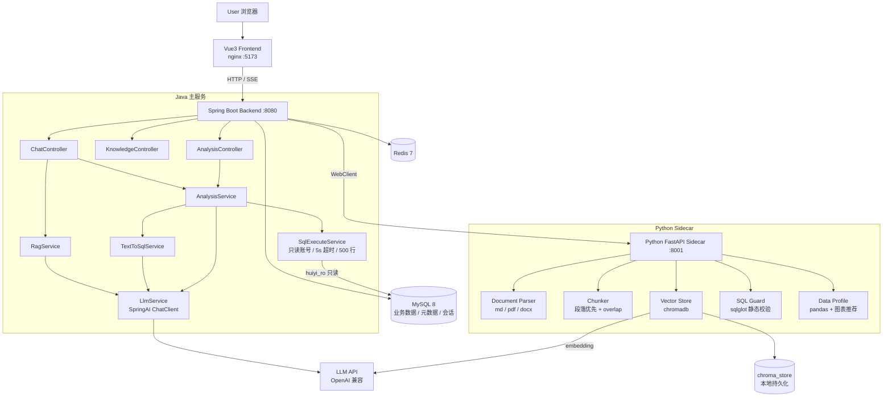

# 架构设计

HuiYi AI Data Assistant 采用 **Java 主服务 + Python Sidecar** 协同架构：Java 承载业务接口、Prompt 编排、LLM 调用、SQL 执行与结果组装；Python 承载文档解析、向量检索、SQL 静态校验与数据画像。

## 总体架构



> 矢量图源码即上方 mermaid 代码；渲染图见 [images/architecture.png](images/architecture.png)。

## 职责边界

| 层级 | 负责 | 不负责 |
|---|---|---|
| Java 主服务 | 接口、会话、意图识别、Prompt 编排、LLM 调用、Text-to-SQL、SQL 执行、结果组装、审计日志 | 文档解析、向量库内部实现、pandas 分析 |
| Python Sidecar | 文档解析、分块、Chroma 读写、embedding 调用、SQL 静态校验、数据画像、图表推荐 | 用户权限、事务、业务接口入口 |
| Vue 前端 | 聊天交互、SSE 流式渲染、上传、表格、图表 | Prompt 拼装、LLM 调用 |
| Chroma | 向量存储与相似检索（cosine） | 权限、业务数据存储 |
| MySQL | 业务数据、文档元数据、会话记录 | 向量相似检索 |

## 核心链路

### RAG 问答

```text
提问 → 意图识别(knowledge_qa) → Python /api/vector/search (top_k=5)
→ 0.5 分阈值过滤 → context 拼装(标注来源) → rag-system.md 渲染
→ LlmService 生成 → 引用来源去重(同名取最高分) → chat_messages 落库
→ 响应(或 SSE 流式: session → token* → references)
```

### Text-to-SQL 数据分析

```text
提问 → 意图层拦截(修改动词直接拒绝) → SchemaService(白名单表结构, 缓存 10min)
→ text-to-sql-system.md 渲染(schema + 业务口径 + 问题) → LLM 生成
→ 三级 SQL 提取(JSON → ```sql 代码块 → 裸 SELECT)
→ Python /api/sql/validate(sqlglot: 单语句 / SELECT-only / 白名单 / 危险函数 / 补 LIMIT 200)
→ SqlExecuteService 只读执行(只读账号 / 5s 超时 / 500 行 / 审计日志)
→ Python /api/data/profile(数值摘要 + 图表推荐) → sql-result-summary.md 总结
→ 组装 question/sql/rows/summary/answer 响应
```

## SQL 安全四道防线

1. **意图层**：问题含删除/修改/更新/清空等动词直接拒绝，不进入 LLM 生成
2. **静态校验层**：sqlglot AST 分析 —— 单语句、SELECT-only（含 CTE/UNION）、表白名单、禁危险函数（SLEEP/BENCHMARK/LOAD_FILE）、禁 INTO OUTFILE、自动补 LIMIT
3. **数据库层**：独立只读账号 `huiyi_ro`（仅 SELECT 权限）+ 只读连接
4. **执行层**：5s 查询超时、500 行上限、全量审计日志（问题/SQL/耗时/行数）

## 配置与密钥

所有敏感配置走环境变量：`LLM_BASE_URL` / `LLM_API_KEY` / `LLM_MODEL` / `LLM_EMBEDDING_MODEL` / `MYSQL_ROOT_PASSWORD`（见 `.env.example`），仓库内无任何硬编码密钥。
