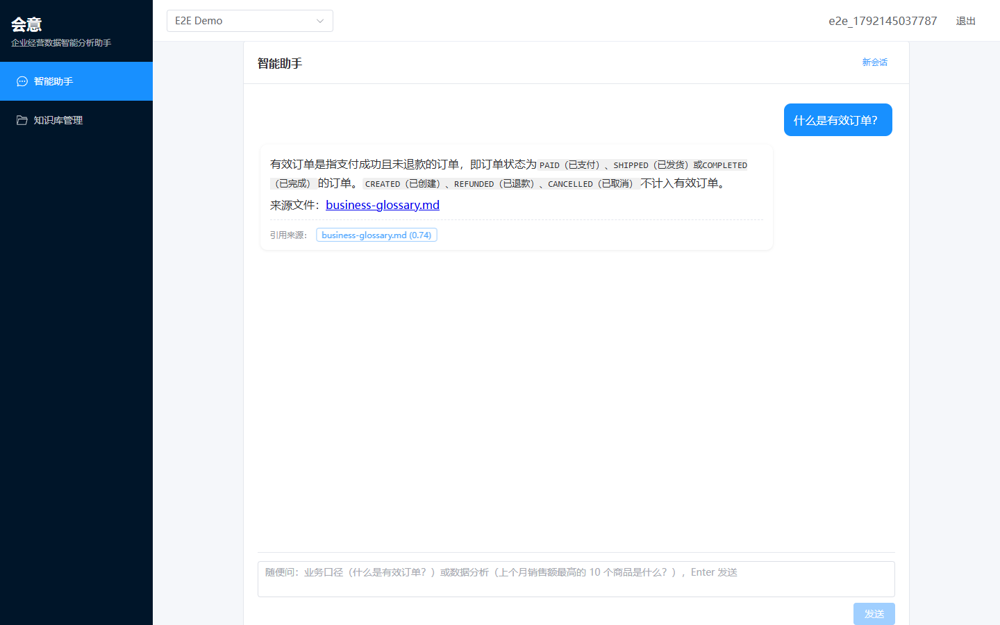
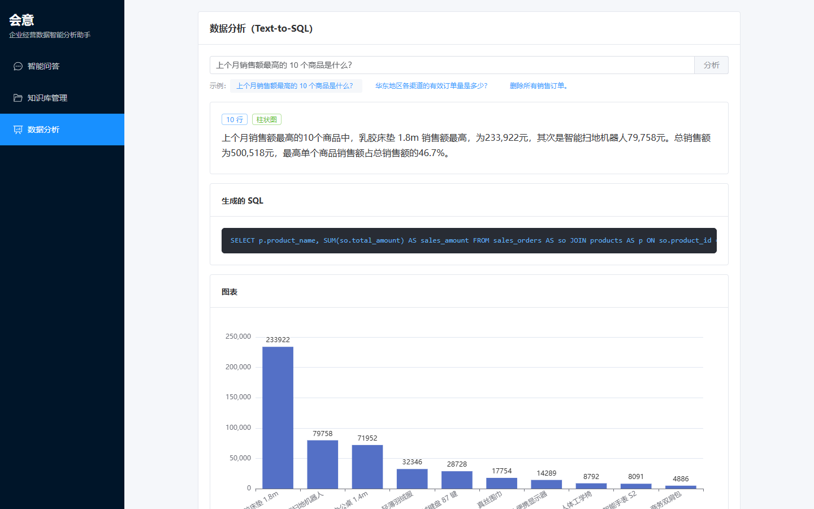
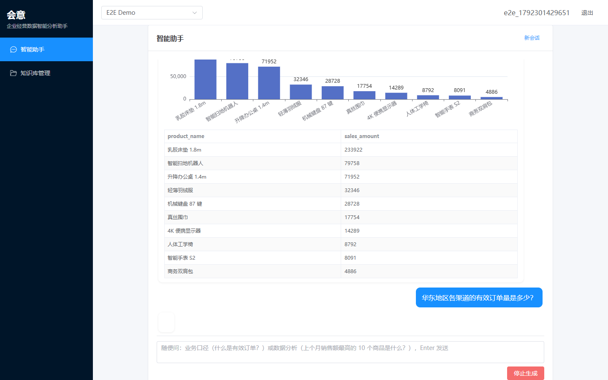
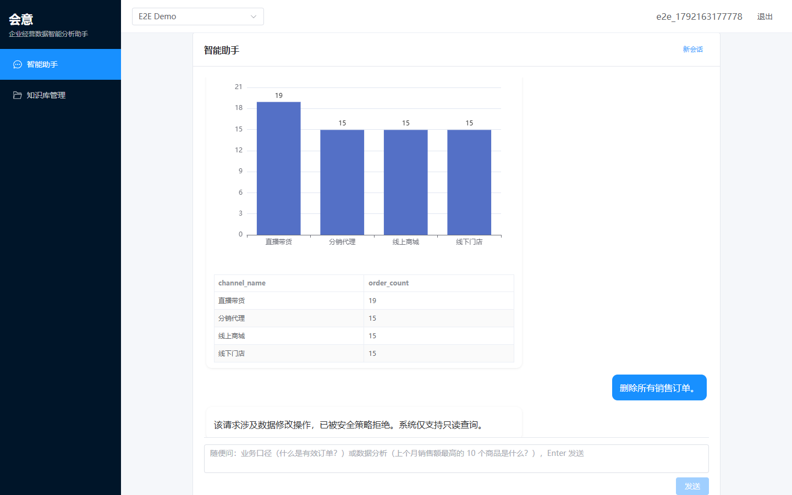
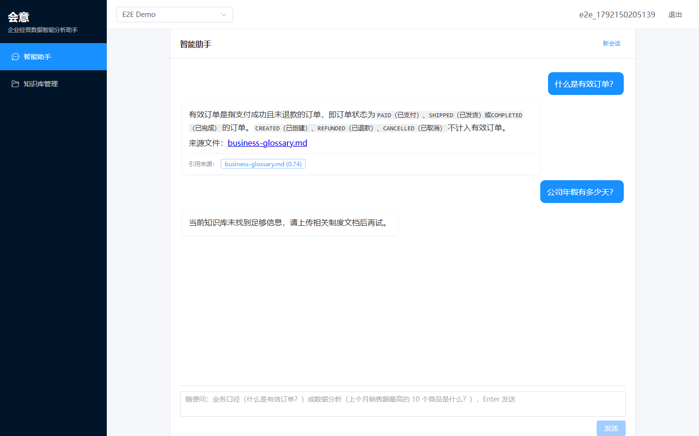

# 演示指南

五个演示场景覆盖系统的两条核心链路与安全防线，均可通过脚本 `scripts/e2e-m5.js` 自动化复验（截图即该脚本产出）。

## 前置准备

```bash
cp .env.example .env   # 配置 LLM 四项
docker compose up -d
# 浏览器访问 http://localhost:5173
```

## 场景 1：业务口径问答（RAG）

1. 进入「知识库管理」，上传 `sample-data/knowledge/business-glossary.md`（列表状态变为「可检索」）
2. 进入「智能问答」，提问：**什么是有效订单？**

期望：流式输出有效订单定义，回答下方展示引用来源 `business-glossary.md` 与相似度分数。



## 场景 2：销售额排名（Text-to-SQL）

进入「数据分析」，提问：**上个月销售额最高的 10 个商品是什么？**

期望：

1. 展示生成的 SQL（`status = 'PAID'` + 上个月日期范围）
2. 商品销售额表格（分页）
3. 柱状图（chartType = bar）
4. 自然语言总结（关键数字与排名）



## 场景 3：渠道分析

「数据分析」提问：**华东地区各渠道的有效订单量是多少？**

期望：按渠道分组的有效订单量表格与柱状图（4 个渠道）、简要分析。



## 场景 4：安全拦截

「数据分析」提问：**删除所有销售订单。**

期望：

```text
该请求涉及数据修改操作，已被安全策略拒绝。系统仅支持只读查询。
```



## 场景 5：知识库未命中兜底

「智能问答」提问：**公司年假有多少天？**（知识库中无相关文档）

期望：

```text
当前知识库未找到足够信息，请上传相关制度文档后再试。
```

且不展示任何引用来源（低分命中已被 0.5 阈值过滤）。



## 自动化复验

```bash
npm i playwright-core
node scripts/e2e-m5.js   # 五场景自动执行并输出截图到 docs/images/
```
